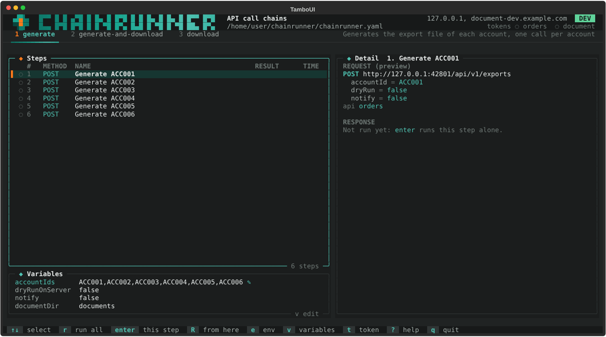
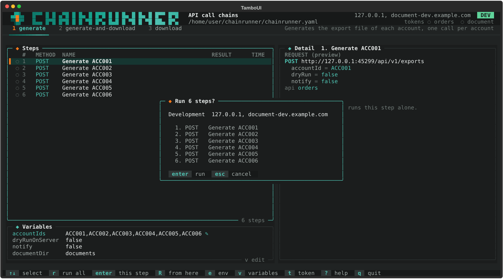

`chainrunner` sans `--run` ouvre l'interface sur l'environnement par défaut et la première séquence
(`-e` et `-s` en choisissent d'autres).

- **En-tête** : l'environnement (en rouge s'il est protégé), les hôtes de ses API, et un jeton par API :
  `✔ orders 4 min` (valide encore 4 minutes), `◌` (pas encore demandé), `✘` (refusé).
- **Onglets** : les séquences, `1` à `9` ou `tab` pour passer de l'une à l'autre.
- **Étapes** : une ligne par étape à faire, après `forEach` ; la colonne de résultat montre le statut
  HTTP, `found` ou `#4` (la tentative d'une attente en cours), `unneeded` ou `timeout`.
- **Détail** : la requête de l'étape sélectionnée (ou la requête SQL avec ses valeurs), puis sa réponse
  ou sa ligne. Avant un lancement, c'est un aperçu ; une valeur qu'une étape précédente extraira est
  affichée comme inconnue.
- **Variables** : les variables du lancement ; `✎` marque celles modifiées pendant la session.

## Touches

| Touche | Effet |
|---|---|
| `r` | lance toute la séquence |
| `enter` | lance l'étape sélectionnée seule |
| `R` | lance de l'étape sélectionnée jusqu'à la fin |
| `x` | s'arrête après l'étape en cours (une attente en cours s'arrête tout de suite) |
| `e` | change d'environnement |
| `v` | modifie une variable pour la session (le fichier n'est pas modifié) |
| `t` | demande un jeton à chaque API maintenant, et montre ce qu'un refus a envoyé |
| `↑ ↓` `j k` | sélectionne une étape |
| `pgup pgdn` `J K` | fait défiler le détail |
| `l` | montre le chemin du dernier journal |
| `?` | l'aide |
| `q` `ctrl-c` | quitte (demande confirmation pendant un lancement) |

Chaque lancement demande une confirmation ; sur un environnement protégé, il faut taper son nom.

## Mots de passe

Un mot de passe laissé vide dans la configuration (`password: ${DEV_PASSWORD:-}` sans valeur dans `.env`)
est demandé avant le premier lancement qui en a besoin, et gardé en mémoire jusqu'à la fermeture de
l'interface. Un jeton ou une connexion à une base refusés avec un mot de passe tapé le redemandent au
lancement suivant.

## Quand le terminal est petit

À partir de 80×24, le détail passe sous les étapes et le logo tient sur une ligne. `CHAINRUNNER_ASCII=1`
remplace les symboles Unicode pour les anciennes consoles, et `NO_COLOR` désactive les couleurs.
