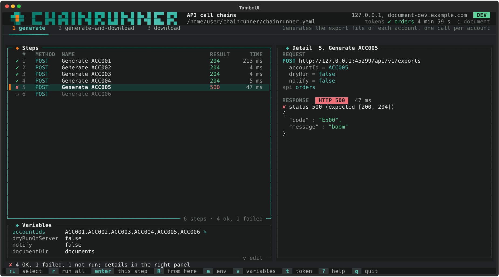

import { Card, CardGrid, LinkCard } from '@astrojs/starlight/components';

<CardGrid>
	<Card title="Plusieurs API, un token chacune" icon="puzzle">
		Grant password ou client credentials, Keycloak ou tout autre serveur de tokens. Un 401
		renouvelle le token et refait l'appel une fois ; les réglages communs d'un environnement sont
		hérités champ par champ.
	</Card>
	<Card title="Des attentes en base" icon="seti:db">
		Une étape poll relance une requête PostgreSQL jusqu'à ce qu'une ligne apparaisse, puis passe ses
		colonnes aux étapes suivantes. Connexions en lecture seule, paramètres liés, jamais concaténés.
	</Card>
	<Card title="Des étapes non nécessaires" icon="approve-check">
		`skipIf` et `onlyIf` lancent une requête avant une étape et la sautent quand le travail est déjà
		fait, sans la compter comme un échec.
	</Card>
	<Card title="Pour chaque valeur" icon="list-format">
		Une étape, ou toute une séquence, pour chaque valeur d'une liste : toutes les générations, puis
		toutes les attentes, puis tous les téléchargements ; ou une valeur à la fois.
	</Card>
	<Card title="Une interface dans le terminal, et une CLI" icon="laptop">
		Choisir un environnement, modifier une variable, tout lancer ou une seule étape, et lire la
		requête et la réponse côte à côte. `--run` fait la même chose dans les scripts et la CI.
	</Card>
	<Card title="Un seul exécutable natif" icon="rocket">
		Compilé avec GraalVM pour Windows, Linux et macOS : pas de JVM à installer, et
		`chainrunner self-update` installe la version suivante.
	</Card>
</CardGrid>

<CardGrid>
	<LinkCard title="Démarrage rapide" description="De la configuration d'exemple à une première exécution." href="getting-started/quick-start/" />
	<LinkCard title="Configuration" description="Toutes les clés de chainrunner.yaml, avec leur valeur par défaut." href="reference/configuration/" />
</CardGrid>
